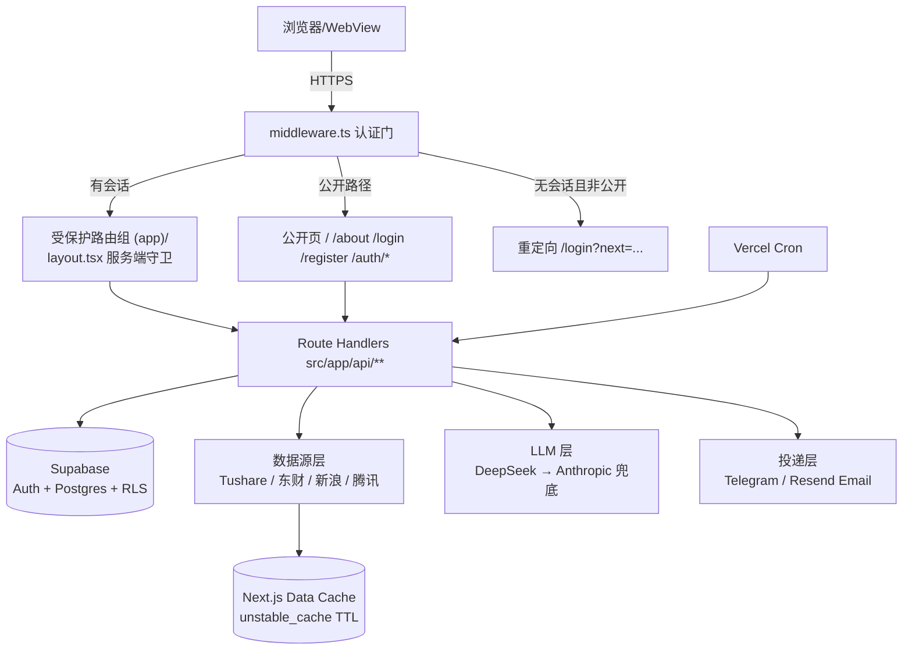

<!-- 04 系统架构 | 用途：osbornalpha 高层技术架构、模块边界、认证门请求流 | 最后更新 2026-06-20 -->

# 04 · 系统架构（System Architecture）

> osbornalpha（代号 stock-monitor）= 多租户 AI 投研 SaaS。
> 技术栈：Next.js 14 App Router + Supabase（Auth / Postgres / RLS，`@supabase/ssr`）+ Tailwind，部署在 Vercel（`osbornalpha.com`，Aliyun DNS）。
> LLM 默认 DeepSeek（Anthropic Claude 兜底）；行情/财务数据来自 Tushare + 东方财富/新浪/腾讯抓取。

---

## 1. 分层总览

```
                          浏览器 / 移动端 WebView
                                   │  HTTPS
                                   ▼
        ┌──────────────────────────────────────────────────────────┐
        │                  Vercel Edge（osbornalpha.com）            │
        │                                                            │
        │   ┌──────────────┐   src/middleware.ts（认证门 / Edge）    │
        │   │  请求进入     │──▶ 校验 Supabase 会话 cookie            │
        │   └──────────────┘     · 公开路径放行 · 受保护路径重定向     │
        │            │                                               │
        │            ▼                                               │
        │   ┌────────────────────┐      ┌──────────────────────────┐│
        │   │ 公开（marketing）   │      │ 受保护路由组 (app)/        ││
        │   │  /  /about          │      │  layout.tsx 服务端二次守卫 ││
        │   │  /login /register   │      │  dashboard watchlist radar ││
        │   │  /forgot /reset     │      │  briefs backtest settings  ││
        │   │  /auth/callback     │      │  stock/[ticker]            ││
        │   └────────────────────┘      └──────────────────────────┘│
        │            │                            │                  │
        │            ▼                            ▼                  │
        │   ┌──────────────────────────────────────────────────────┐│
        │   │  Route Handlers  src/app/api/**  (Node serverless)     ││
        │   │  quote kline financials radar signals perspectives     ││
        │   │  watchlist search calendar holders flows brief         ││
        │   │  cron diag cache auth                                   ││
        │   └──────────────────────────────────────────────────────┘│
        │            │            │             │            │       │
        └────────────┼────────────┼─────────────┼────────────┼───────┘
                     ▼            ▼             ▼            ▼
            ┌────────────┐ ┌────────────┐ ┌──────────┐ ┌───────────┐
            │  Supabase  │ │ 数据源层    │ │ LLM 层    │ │ 投递层     │
            │ Auth/PG/   │ │ Tushare    │ │ DeepSeek  │ │ Telegram  │
            │ RLS        │ │ 东财/新浪/  │ │ ↳ Anthropic│ │ Resend    │
            │            │ │ 腾讯抓取    │ │  (兜底)    │ │ (Email)   │
            └────────────┘ └────────────┘ └──────────┘ └───────────┘
                                  │
                          Next.js Data Cache（unstable_cache，TTL）
```



---

## 2. 客户端层（Next.js App Router）

- **框架**：Next.js 14 App Router，React 18，TypeScript，Tailwind（`tailwind-merge` + `clsx`），`geist` 字体，K 线用 `lightweight-charts`，Excel 导出用 `xlsx`。
- **路由分组**：
  - **公开 marketing**：`/`（落地页）、`/about`、`/login`、`/register`、`/forgot-password`、`/reset-password`、`/auth/*`（OAuth/邮件回调）。
  - **受保护路由组** `src/app/(app)/`：`dashboard`、`watchlist`、`radar`、`briefs`（+ `briefs/[date]`）、`backtest`、`settings`、`stock/[ticker]`。该组共享 `(app)/layout.tsx`，内含 `TopBar` + `TabBar` 外壳。
- **Supabase 客户端封装**：
  - `src/lib/supabase/client.ts` — `getBrowserSupabase()`（`createBrowserClient`，浏览器侧）。
  - `src/lib/supabase/server.ts` — `getServerSupabase()`（`createServerClient` + Next `cookies()`，RSC/Route Handler 侧，写 cookie 失败时静默忽略以兼容 RSC 上下文）。
  - 两侧均带 `*IsSupabaseConfigured()` 判定：URL/Key 缺失或含 `placeholder` 时视为未配置（本地开发可零环境变量运行，认证门自动关闭）。
- **类型**：`src/lib/supabase/database.types.ts` 手写镜像迁移（含 `Database` 泛型、各表 Row/Insert/Update 与枚举 `Market/Stance/Persona`）。

## 3. 认证门请求流（Auth Gate，2026-06-20 上线）

产品**非公开浏览**：除 marketing 落地页与认证页外，一切需要 Supabase 会话。两道防线：

1. **Edge 中间件** `src/middleware.ts`：
   - `PUBLIC_PATHS = { /, /about, /login, /register, /forgot-password, /reset-password }`；额外放行 `/auth/*`（OAuth/邮件回调）与 `/api/*`（API 自带 RLS/鉴权）。
   - 用 `createServerClient` 读 cookie → `supabase.auth.getUser()`。
   - **已登录**访问 `/login` 或 `/register` → 重定向 `/dashboard`。
   - **未登录**访问非公开路径 → 重定向 `/login?next=<原路径>`。
   - 当 Supabase 环境变量缺失/为 placeholder 时**直接放行**（本地开发不阻塞）。
   - `matcher` 排除 `_next/static`、`_next/image`、`favicon.ico`。
2. **服务端兜底守卫** `src/app/(app)/layout.tsx`：若 Supabase 已配置，再次 `getServerSupabase().auth.getUser()`，无 user 则 `redirect('/login')`。即使中间件被绕过也不泄漏受保护页面。

> 历史共享口令门（`SITE_PASSWORD` / `SITE_AUTH_SECRET` / `unlock` / `site-password.ts`）已**全部移除**，改为 Supabase 会话 + RLS。

请求时序：

```
请求 → middleware（公开?）
        ├─ 是 → 直接渲染
        └─ 否 → getUser()
                 ├─ 有 user → 进入 (app)/layout.tsx → 再次 getUser() → 渲染页面
                 └─ 无 user → 302 /login?next=<path>
```

## 4. Supabase 层（Auth / Postgres / RLS）

- **Auth**：邮箱+密码、Magic Link、OAuth（Google/GitHub/Apple）。注册触发器 `handle_new_user()`（`security definer`）自动为新用户建默认股票池「我的股票池」、`user_preferences` 行与 `profiles` 行。
- **Postgres + RLS**：11 张表全部启用行级安全。公共参考表（`stocks_universe`、`financial_history`）`select using (true)` 公开可读；其余按 `auth.uid() = user_id`（或 `= id`）严格隔离。详见 `05_DATA_MODEL_AND_SCHEMA.md`。
- **多租户隔离实证**：两个账户互相看不到对方 watchlist/briefs/perspectives，由 RLS 在数据库层强制，而非应用层过滤。
- **计费钩子**：`profiles.plan/role/usage/stripe_customer_id` 为预留字段，`src/lib/billing/entitlements.ts` 只读映射为能力位（`maxWatchlistItems`/`aiCommitteePerDay`/`canExport`），Phase 1 不强制、未接 Stripe。

## 5. 数据源层（`src/lib/data/sources/`）

| 模块 | 用途 | 鉴权 | 备注 |
|---|---|---|---|
| `tushare.ts` | A 股深度数据（日线、daily_basic、fina_indicator、income/balance/cashflow、十大股东/流通股东、北向、涨跌停、公告、披露/预告/分红/解禁日历） | `TUSHARE_TOKEN`（POST body） | 低层 `tushareCall()`，8s 超时 |
| `tushare-cached.ts` | 上述 fetcher 的 `unstable_cache` 包装（drop-in 替换） | 同上 | TTL：daily 6h、daily_basic/holders/日历 24h、财报 7d、flows/limit 6h；tag `tushare` 全局可 `revalidateTag` |
| `eastmoney.ts` | 东方财富免费快照 + K 线（行情主源） | 无 | `push2delay`/`push2his`，secid 映射 |
| `sina.ts` | 新浪财经行情（兜底，GBK，`iconv-lite` 解码） | 无 | Vercel US egress 已验证可达 |
| `tencent.ts` | 腾讯财经行情（第三兜底，GBK） | 无 | `qt.gtimg.cn` |
| `anthropic.ts` | Claude API（perspectives 兜底 / 高级合成） | `ANTHROPIC_API_KEY` | haiku/sonnet/opus |
| `deepseek.ts` | DeepSeek（OpenAI 兼容，LLM 默认） | `DEEPSEEK_API_KEY` | `deepseek-chat` 默认，可切 `deepseek-reasoner` |
| `llm.ts` | 统一 LLM 门面 `chat()` + `extractJson()` | — | 解析顺序 DeepSeek→Anthropic，`LLM_PROVIDER` 可固定；附 `est_cost_usd` |
| `resend.ts` | Resend Email 投递 | `RESEND_API_KEY` | 简报/雷达邮件 |
| `telegram.ts` | Telegram Bot 推送 | `TELEGRAM_BOT_TOKEN`+`TELEGRAM_CHAT_ID` | MarkdownV2 转义 |

行情主链路：**东方财富 → 新浪 → 腾讯** 级联兜底；A 股基本面/财务由 Tushare 补充。所有数据源均带「未配置/不支持/出错」的优雅降级标记，不静默失败。

## 6. LLM 层（AI 投研委员会）

- 9 位投资人格（`src/lib/data/personas.ts`：巴菲特/芒格/Druckenmiller/Marks/林奇/Burry/张坤/李录/段永平），各含角色信念、反模式与严格 JSON 输出 schema。
- `llm.ts` 统一门面：优先 DeepSeek（成本约为 Sonnet 的 1/8~1/10），无则回退 Anthropic；按 model 估算 `est_cost_usd`。
- 消费方：`/api/perspectives/[ticker]`（9 人格并发）、`/api/brief/*` 与 cron 简报合成。

## 7. 投递与定时

- **投递层**：Telegram（`telegram.ts`）+ Email（`resend.ts`），由对应环境变量门控，缺失则跳过该渠道。
- **Vercel Cron**（`vercel.json`）：
  - `/api/cron/daily-radar` — `0 0 * * *`（UTC 00:00 = 北京 08:00）。
  - `/api/cron/daily-brief` — `30 0 * * *`（UTC 00:30 = 北京 08:30）。
  - 两者用 `Authorization: Bearer ${CRON_SECRET}` 鉴权（radar 在 `preview=1` 时跳过）。

## 8. 部署拓扑

- **Vercel**：生产域 `osbornalpha.com`（Aliyun DNS A/CNAME → Vercel）。Route Handlers 为 Node serverless function；重负载路由设 `maxDuration`（30/60s）。
- **缓存**：Next.js Data Cache（`unstable_cache`，TTL 见上）跨冷启动持久，零外部缓存基础设施；静态资源/图片走 Vercel CDN（`images.unoptimized = true`）。
- **历史**：曾在 EdgeOne Pages 部署（见 `docs/EDGEONE_DEPLOY.md`），现以 Vercel 为准。详见 `26_OSBORNALPHA_ARCHITECTURE.md`。
