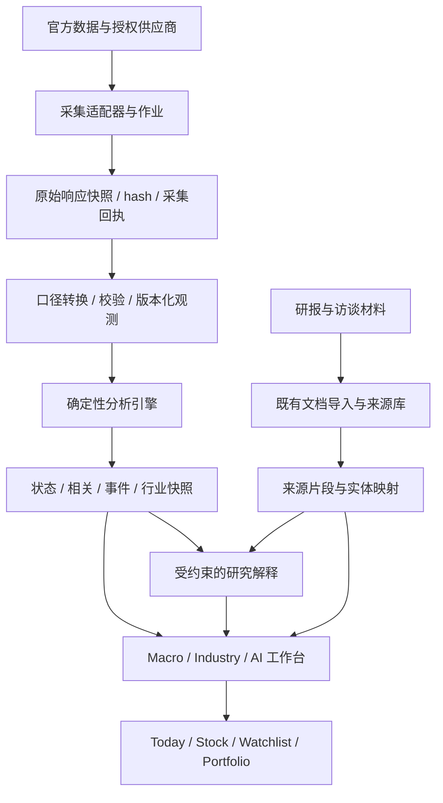

# ChaosAI 功能、数据源与 OsbornAlpha 集成研究

研究日期：2026-11-04（北京时间）  
目标：研究 ChaosAI 的公开能力，以 OsbornAlpha 的设计语言和现有工程基础独立实现，集成到 osbornalpha.com。  
本地代码基线：`fc42b06`。本次交付是研究报告与实施设计，未修改应用、数据库或线上部署。

## 1. 架构结论与建议

**值得建设，但应定位为 OsbornAlpha 的“宏观与产业研究工作台”。最值得借鉴的是从指标到解释、从解释到行业与公司的研究路径，以及就地展示来源的方式。工程重点应放在可验证的数据和计算链上。**

建议分成四个产品能力：

1. **宏观工作台**：中美指标、经济状态、政策事件、资产表现、情景分析。
2. **行业工作台**：财务聚合、估值历史、景气变化、产业链与公司映射。
3. **AI 产业观测**：模型能力、价格、使用度、开源活跃度，连接上市公司研究。
4. **研究证据系统**：报告、访谈、来源片段、结论更新、观察清单和组合复盘。

首期应完成“真实宏观数据 → 同一快照计算 → 可解释状态 → Today 摘要 → 来源追溯”的闭环。行业全量财务历史、外资报告库和多媒体全文库需要不同的数据与内容流程，应分期接入。

**不建议把对方数据、分类结果或研究结论直接导入生产。** 本次发现了相关系数与解释相反、汇率使用利率规则、日期重复、来源已停止提供对应数据、指标占位等具体问题。它适合作为产品参考，不能作为已验证的行情或策略数据库。

## 2. 研究范围与证据边界

### 2.1 本次检查了什么

- 从用户提供的[宏观策略页](https://www.chaosaiagent.com/macro-strategy)出发，读取全部公开顶层研究入口。
- 深读宏观页全部主要板块、行业总览、竞争分析、公司监控、行业数据的八个子模块；抽样阅读 AI Agent 行业、NVDA/AMD 对比、访谈和 a16z 播客目录。
- 读取宏观历史表和 Token 经济模型公开嵌入的 HTML。
- 检查页面交付给访客的 HTML、序列化指标元数据和部分公开 JavaScript，确认数据组织方式及客户端模块结构；没有访问管理后台或尝试获取私有源码。
- 对照 FRED、AKShare、OpenRouter、Artificial Analysis、Hugging Face、GitHub 等官方文档。
- 阅读 OsbornAlpha 的 UI tokens、应用壳、宏观卡片、行情适配、研究来源、采集器、组合、LLM 与任务调度代码。

### 2.2 证据分级

| 标记 | 含义 | 适用结论 |
|---|---|---|
| 页面观察 | 当次公开 HTML / 内嵌内容可见 | 板块、来源标签、更新时间、展示错误 |
| 资源观察 | 访客公开 JS / 序列化数据可见 | 客户端模块、静态内容、数据字段、重复日期 |
| 官方核对 | 数据提供方文档支持 | 数据含义、API 能力、停服或迁移事实 |
| 架构建议 | 为 OsbornAlpha 新设计 | 路由、表结构、作业、SLO、分期 |
| 待验证 | 当前证据不足 | 真正后台实现、生产凭据、付费权限、点击结果 |

本地浏览器访问被 Work 设置禁用，因此**没有完成视觉截图、点击、hover、移动端、登录态和真实网络性能测试**。不能据此声称交互已经跑通。公司与外资研报页的初始 HTML 只有壳层，公开客户端资源可补充其功能结构，但不是实际交互验证。

网页搜索缓存与当次直接读取存在差异。例如监控页缓存显示 23 家公司、10 月 9 日更新，当次直接响应显示 25 家、10 月 22 日更新。报告优先采用直接响应，数量只作为本次快照。

这不是数百篇内容的逐篇事实审计，也没有验证对方全部原始报告。本次覆盖深度见同目录 `PAGE_INVENTORY.csv`；供应商可接入性与对方来源声明见 `SOURCE_MAP.csv`。来源标签不等于已经验证的上游调用。

## 3. 网站的产品结构：功能如何串起来

| 页面 | 观察到的能力 | 真正需要建设的底层能力 | OsbornAlpha 落点 |
|---|---|---|---|
| 宏观策略 | 中美状态、指标时间线、关联分析、传导机制、历史周期 | 时序数据、口径转换、规则引擎、事件库 | `/intel/macro`，摘要进入 `/today` |
| 行业研究 | 生命周期、财务热力图、景气雷达、历史估值、细分行业目录 | 行业成员历史、财务聚合、估值序列、研究分类 | `/intel/industries` |
| 公司研究 | 客户端资源有覆盖表、筛选、评级、估值及研究入口 | 证券主数据、报告版本、情景估值 | 扩展现有 `/stock/[ticker]` |
| 竞争分析 | 多公司对比报告、财务与护城河比较 | 同口径财务指标、同业组、证据化论点 | `/intel/compare` |
| 专题研究 | 分类目录、AI 摘要、创始人访谈入口 | 文档导入、提取、检索、引用与发布 | 复用 Research OS Library / Sources |
| 外资研报 | 客户端资源有机构报告目录、评级、目标价、PDF 元信息与可视化入口 | 机构报告元数据、权限、页码引用、摘要版本 | 私有研究库中的机构报告视图 |
| 模拟组合 / 公司监控 | 公司跟踪时间线、筛选、观点与估值变化；组合部分初始为加载状态 | 观点事件、估值版本、模拟账本、绩效复盘 | 复用 `/portfolio`、Analyst 与 Theses |
| 行业数据 | 八组 AI 产业数据入口 | 多来源采集、实体映射、快照差分 | `/intel/ai-ecosystem` |
| 他山之石 | 播客/访谈目录、章节、观点、中英内容 | 音视频转写、时间戳、人物/公司映射 | 研究库中的媒体证据视图 |

上述结构来自[行业研究](https://www.chaosaiagent.com/industries)、[竞争分析](https://www.chaosaiagent.com/competition)、[专题研究](https://www.chaosaiagent.com/research)、[监控页](https://www.chaosaiagent.com/monitor)、[行业数据](https://www.chaosaiagent.com/industry-data)和[他山之石](https://www.chaosaiagent.com/benchmark)。公司、外资研报能力另由对应页面公开客户端资源补充。

### 3.1 应学习的产品能力

**逐层解释。** 用户可以先看一个状态，再查看驱动因素、图表和来源。这比单独堆砌数据更接近研究工作。

**同一主题跨层连接。** 宏观变化可以连接到资产，再连接行业和公司；AI 模型价格、能力、开源活动则可以成为公司财务之外的交叉证据。

**研究对象持续跟踪。** 监控页不是只有一篇静态报告，而是展示新信息如何改变原结论。OsbornAlpha 已有 thesis、signals、changes 和 analyst 基础，适合做得更完整。

**把研究框架做成可操作工具。** Token 单位经济学页有自建/租赁模式和参数联动的设计，适合变成可保存假设的情景工具。[Token 模型页面](https://www.chaosaiagent.com/industries/token-interactive)

### 3.2 不应照搬的产品结构

- 不继续增加一长排一级导航。OsbornAlpha 已有七个主要入口，应把新能力收敛到 Intel，并从 Today、Stock、Portfolio 交叉进入。
- 不让报告页彼此孤立。每份报告应绑定实体、日期、来源和结论版本。
- 不把来源路径、脚本名和后台实现细节当作用户理解数据的唯一入口。
- 不把“历史观察”“规则得分”“研究员假设”“模型预测”都呈现成相同的确定性结论。

## 4. 宏观策略页：逐板块拆解

### 4.1 中美经济状态与美林时钟

页面展示四象限、驱动指标、贡献规则、资产配置模板、流动性阶段和偏差案例。公开元数据包含指标类别、单位、权重、当前值、前值、日期和历史序列；页面直接说明分类实现与同步脚本的文件名。[宏观页](https://www.chaosaiagent.com/macro-strategy)

**工程判断：** 这是可解释规则评分与研究文本组合的证据，不能据此认定它使用了经过统计校准的概率模型。也无法从文件名判断后台采集是否持续成功。

建议 OsbornAlpha 第一版：

- 把经济周期拆成“增长动能”和“通胀动能”两条主轴；政策、流动性、风险偏好作为补充状态。
- 美国和中国分别定义指标集合、阈值和解释；金融条件不直接替代经济增长。
- 初版输出“状态评分/支持度”，保留贡献明细，避免直接称为概率或胜率。
- 数据覆盖率、数据新鲜度、状态分歧、历史校准表现分开显示。
- 四象限资产配置只作为可编辑研究情景；不能把一套固定比例直接转成用户组合交易。
- 每次规则修改产生 `methodology_version`；历史快照保留旧版本，不回写成新规则结果。

### 4.2 指标汇总与详情

推荐信息顺序：**当前值 → 与上一可比期的变化 → 数据期 → 发布时间 → 走势 → 事件 → 计算口径 → 来源**。

具体差异必须类型化：

| 数据类别 | 应表达的变化 | 常见错误 |
|---|---|---|
| 利率与收益率 | 百分点或基点变化 | 把 25bp 写成上涨 25% |
| CPI / PPI 指数 | 指数水平、同比、环比分开 | 把指数值当同比；对同比再次求同比 |
| 失业率 | 百分点变化及平滑趋势 | 把上升解释为所有资产都利空 |
| PMI | 指数水平与变化点数 | 48→49 仍收缩，但边际改善 |
| M2 / 社融 | 存量同比与增量分开 | 将新增融资量当存量增速 |
| GDP | 单季/累计、同比/环比分开 | 把季度数据填成每月独立观测 |
| 汇率 | 报价方向及百分比变化 | USD/CNY 上涨误称人民币升值 |
| 股价 / ETF | 价格收益、总收益、复权口径 | 忽略分红、拆股、币种和时区 |

页面中国汇总标题写 13 项，但本次可见汇总行数为 12 项，包含合并展示的 MLF/LPR 三项。实现时数量应从 catalog 自动计算，不手写在标题里。

### 4.3 相关分析和回归

这一功能应保留，但要重新定义分析问题：用户究竟在比较“两个水平值是否同向”，还是“宏观变化之后资产收益如何变化”？两者不可混用。

建议提供四种分析：

1. 水平相关：用于描述，同时提示趋势可能产生伪相关。
2. 变化相关：利率变化与资产收益、通胀变化与收益等。
3. 滚动相关：查看不同阶段关系是否稳定。
4. 事件窗口：政策或数据发布前后表现；明确窗口与可得信息。

每个结果携带样本区间、频率、样本数、缺失处理、变换、滞后方向和方法版本。季度序列被展示性延展为月频后，不能按新增独立样本计算显著性。排序显示的高相关结果也不应被自动写成最强因果解释。

文字先由确定性规则生成统计事实，例如“本窗口相关为正，解释力有限”；LLM 只能补充有来源的解释与反例。不得覆盖统计符号，也不得从相关系数推导预期收益。

### 4.4 宏观传导与跨境机制

传导图适合成为“研究假设图”：政策 → 资金成本/流动性 → 汇率/贴现率/盈利 → 行业暴露 → 用户观察对象。

节点要标明属于观测数据、推导指标还是机制假设。边需要保存条件、时间尺度、证据和反例。点击节点打开指标或来源，点击行业进入行业页，点击公司进入已有 Stock 页。

“中美利差”必须由同期限的两国收益率计算；VIX 只能作为市场风险代理，不能在资金流节点中代替实际跨境资金流。美元指数、美元兑人民币、人民币中间价、离岸人民币应有不同的序列 ID。

### 4.5 历史周期资产表

宏观页内嵌的[历史资产表](https://www.chaosaiagent.com/macro-strategy/cycle-asset-table/index.html)列出八个政策周期，底部来源比主页面丰富，见下一节。它本质上是周期描述，不等同于策略回测。

重建时应支持：事件日、事件后首个可交易时点、月末三种边界，并显式标记。默认按事件研究使用可交易边界；用月末值则明确标为月度观察。收益率变化用 bp，价格收益用 %，不能混为一种“涨跌”。

指数真实发布前的回溯序列需要 `backfilled=true`；期货要记录连续合约及展期方法；ETF 要区分价格收益和含分红总收益。用户应该能够看到一次分析的实际起止观测，而不只是彩色百分比。

## 5. 数据源地图与实际接入方案

### 5.1 美国宏观与市场指标

下表的站点标识来自公开页面/序列化元数据。建议源是 OsbornAlpha 的新接入设计，不表示已获取相应生产授权。

| 指标 / 站点代码 | 站点标注 | OsbornAlpha 接入建议 | 必须处理 |
|---|---|---|---|
| 有效联邦基金利率 `DFF` | FRED | FRED series observations | 实际成交利率与 FOMC 目标区间不同；日频 |
| 美债十年 `DGS10` | FRED | FRED；必要时核对官方国债收益率 | 节假日空值；变化单位 bp |
| 广义美元 `DTWEXBGS` | FRED | 单独保留 FRED 广义贸易加权指数 | 不与 DXY 拼接 |
| 美元指数 `DX-Y.NYB` | Yahoo | 有覆盖和展示权的数据供应商 | 是另一指数；供应商代码不作为内部主键 |
| CPI `CPIAUCSL` | FRED | 存原指数，再派生同比 | 季调口径与新闻常用非季调同比区分 |
| 失业率 `UNRATE` | FRED | FRED / BLS 可核对 | 发布日期与数据月份不同 |
| 制造业 PMI `NAPM` | FRED | ISM 或授权供应商；缺源则缺失 | FRED 此入口已转向移除公告 |
| PPI `PPIFIS` | FRED | FRED 原序列 + 显式同比变换 | 官方名称为最终需求，非页面所称制成品 |
| VIX `VIXCLS` | FRED | FRED 序列，核对来源使用条件 | 日频；不能当真实资金流 |
| 股票指数、TLT、黄金/铜/原油期货 | Yahoo 元数据 | 先检查已有 DataGateway 的品类覆盖 | 指数/证券/期货分别建契约，核验复权和连续合约 |

官方证据：[FRED API](https://fred.stlouisfed.org/docs/api/fred/)、[ISM 数据移除公告](https://fred.stlouisfed.org/news/2016/06/institute-for-supply-management-data-to-be-removed-from-fred)、[CPIAUCSL 定义](https://fred.stlouisfed.org/series/CPIAUCSL)、[PPIFIS 定义](https://fred.stlouisfed.org/series/PPIFIS)、[DTWEXBGS 定义](https://fred.stlouisfed.org/series/DTWEXBGS)。

建议额外评估实际 GDP、工业生产、核心 PCE、收益率曲线和央行资产负债表，但它们是增强项，需要另做指标定义和权重验证，不能为了增加数量直接混入评分。

### 5.2 中国宏观：原发布机构与采集工具分开

| 指标 | 站点 ID | 原发布/核对方向 | 接入与口径要求 |
|---|---|---|---|
| MLF 1Y | `CN_MLF_1Y` | 人民银行公开操作公告 | 操作日期、工具期限、制度变更独立记录 |
| LPR 1Y / 5Y+ | `CN_LPR_1Y` / `CN_LPR_5Y` | 全国银行间同业拆借中心 / 人民银行 | AKShare `macro_china_lpr` 可作适配入口，字段要区分旧贷款基准利率 |
| 中国十年国债 | `CN_CGB_10Y` | 中债 / 已授权供应商 | 收益率类型、期限、交易日 |
| USD/CNY | `CN_USDCNY` | 外汇交易中心 / 外汇局 / 授权供应商 | 中间价、在岸收盘、离岸价不能互换 |
| CPI / PPI 同比 | `CN_CPI_YOY` / `CN_PPI_YOY` | 国家统计局 | 原发布同比优先，保留原表和报告期 |
| GDP 同比 | `CN_GDP_YOY` | 国家统计局 | 季度、累计与单季口径 |
| M2 同比 | `CN_M2_YOY` | 人民银行 | `macro_china_money_supply` 为适配候选，原提供方与转载方分别存储 |
| 社融存量同比 | `CN_SHRZ_YOY` | 人民银行存量统计 | 不可用 `macro_china_shrzgm` 的增量直接替代 |
| 制造业 PMI | `CN_PMI` | 国家统计局 | 官方制造业与其他机构 PMI 分系列 |
| 出口美元同比 | `CN_EXPORT_YOY` | 海关总署 | 美元/人民币、当月/累计、春节合并口径 |

AKShare 是采集适配库，不是统一的原始数据发布者。它的文档明确写出部分接口上游是东方财富、商务数据中心等；`macro_china_shrzgm` 返回融资**增量**。因此来源链应存“原发布机构 → 分发网站 → 适配器”，而不是只写 AKShare。[AKShare 中国宏观文档](https://akshare.akfamily.xyz/data/macro/macro_china.html)

原发布核对入口包括[国家数据](https://data.stats.gov.cn/)、[人民银行社融存量统计示例](https://www.pbc.gov.cn/diaochatongjisi/attachDir/2025/11/2025110416000670943.pdf)。这些链接说明来源方向，不是已验证的所有自动化接口合同。

### 5.3 历史资产表的独立来源

这是用户提到“各板块最下面数据来源”中最容易遗漏的一组。表内明确列出：

| 内容 | 该表声明的来源 | 集成建议 |
|---|---|---|
| 中美港主要指数 | MiniMax Finance 指数日行情 API | 具体供应商、接口、可得性尚未独立确认；优先检查现有行情供应商 |
| DXY | Statista，底层 ICE | 接授权指数数据；不要用广义美元无提示替代 |
| USD/CNY | CurrencyNews + 外汇局中间价 | 拆开不同汇率口径，不拼接成同一收盘序列 |
| 美债十年 | FRED H.15 月末数据 | 重建为可核对的 series 和取值规则 |
| 黄金 | World Bank Pink Sheet + Goldprice.today | 月均、月末、年末不是同一种观测 |
| WTI / Brent | WorldOilMonitor / EIA | 统一现货/期货、频率与收盘定义 |
| 铜 / 铝 | Metalcharts.org / Macrotrends | 核验 LME 现货、三月期与数据使用范围 |
| 政策日期 | FOMC + Investopedia / 百度百科 | 原始事件只从官方政策公告确立 |

以上是**对方的来源声明**，不是本报告为这些数据真实性背书。表内同时混用了月末说明和指数精确交易日说明，重建时需逐资产明确边界。[历史表来源区](https://www.chaosaiagent.com/macro-strategy/cycle-asset-table/index.html)

### 5.4 行业财务与估值来源

[行业页](https://www.chaosaiagent.com/industries)标注恒生聚源，季度财务来自 XLSX，估值来自申万周频历史。这里有三层独立成本：供应商数据、行业成分历史、财务聚合方法。

- 优先盘点现有 DataGateway / Wind、Tushare 等已具备的字段及使用范围；本仓库存在行情适配，不代表宏观、行业财务权限已经开通。
- 若采用独立聚合，必须保存历史行业成员和分类版本，不能把今天的成分股用于全部历史。
- 收入和利润先明确汇总口径；毛利率不能直接平均公司比率；金融行业适用性单列。
- 单季值从累计财报差分时，要使用一致版本；缺报、退市、重述、财年不同均要标记。
- PE 负数/无意义时显示“不适用”；PB/PS 的历史低分位也不能自动解释成低估。
- 从 31 个行业、约十年序列扩展到细分产业前，先把一个行业的端到端结果与参考原表逐行核对。

### 5.5 AI 生态八组数据

| 子模块 | 页面披露的来源/状态 | 建议接入方式 | 研究含义与边界 |
|---|---|---|---|
| [OpenRouter 榜单](https://www.chaosaiagent.com/industry-data/llm-rankings) | `api/frontend/v1/rankings/apps`，多榜单和时间窗 | 官方可用 API 优先；公开前端榜单接口独立降级与缓存 | 平台内使用份额不代表全行业份额；模型目录 API 不能替代使用榜 |
| [AA 能力榜](https://www.chaosaiagent.com/industry-data/llm-rankings/aa-leaderboards) | 当前子页只保留通用 LLM，目录仍描述四类 | Artificial Analysis 正式 Data API | 保存评测版本、模型配置、吞吐/延迟定义；套餐决定字段 |
| [AICPB](https://www.chaosaiagent.com/industry-data/aicpb-rankings) | 网站流量排名；版次与页脚数据月份不同 | 月度快照或供应商许可导入；API 能力待确认 | Website 访问量不是用户数、App MAU 或收入 |
| [厂商工程实力](https://www.chaosaiagent.com/industry-data/ai-ecosystem) | Hugging Face + GitHub | 官方 Hub API / GitHub REST，日快照 | 开源观测不是全公司研发投入 |
| [技术趋势](https://www.chaosaiagent.com/industry-data/ai-trends) | HF trending/newest + GitHub Trending | 官方元数据 + 自建增量历史，榜单作辅助 | stars 是关注信号；净增量和新增 star 数不同 |
| [Token 价格](https://www.chaosaiagent.com/industry-data/llm-pricing) | `AgentOps-AI/tokencost` JSON | 固定 commit SHA 的快照 + 厂商官方定价校核 | 输入/输出、缓存、batch、长上下文、币种分别存 |
| [Arena](https://www.chaosaiagent.com/industry-data/arena-leaderboards) | 本次 Text 显示抓取失败、0 模型/票 | 原站支持的数据渠道；失败保留旧快照 | 抓取失败不能转成零表现；不同任务榜不可直接比 |
| [Jefferies AI 跟踪](https://www.chaosaiagent.com/industry-data/jefferies-ai-data-tracking) | 研报拆表；初始 HTML 可见七类 tab | 受控文档导入与表格提取 | 属于报告内容链，不是已验证的实时数据 API |

官方技术依据：[OpenRouter 模型目录 API](https://openrouter.ai/docs/api/api-reference/models/list-all-models-and-their-properties)、[Artificial Analysis Data API](https://artificialanalysis.ai/data-api/docs)、[Hugging Face Hub API](https://huggingface.co/docs/hub/api)、[GitHub starring API](https://docs.github.com/en/rest/activity/starring)、[tokencost 仓库](https://github.com/AgentOps-AI/tokencost)。

GitHub 当前文档对 stargazer 列表有访问限制，不能预设可以完整回填所有仓库的历史。首版每天保存仓库 star 总数并计算净变化即可，准确标名。HF 下载统计也必须核验字段统计窗口，不能未经核对写成历史累计下载。

AA 子页的旧链接 404 并不能证明原供应商永久取消某类服务。其当前正式 API 文档仍有媒体端点，因此应检查新契约，避免把一次网页路径失效等同于能力消失。

### 5.6 内容来源与事实来源应分开

公司页公开资源的来源指向内部 Markdown 汇总与深度报告；外资研报是机构报告再组织；a16z 目录披露了音频转写、翻译及 HTML 产物流程。[a16z 目录](https://www.chaosaiagent.com/benchmark/a16z-show)

这类资料应采用独立的文档管道：导入 → 文件 hash → 文档元数据 → 结构化提取 → 人工复核关键表格 → 摘要与观点 → 来源页码/时间戳。报告作者的估值或胜率属于其判断，不能变成行情事实字段。

公开展示与私有研究导入分开配置；是否能对外展示全文、表格、长篇翻译，按具体内容授权确认。对外默认采用元数据、原链接和独立撰写的分析，来源注释不能代替内容使用权限。

## 6. 关键质量问题：证据、影响与防线

这些是本次快照中的观察，不能据此判断维护者动机，也不能推断所有历史数据均无效。

| 编号 | 观察与证据 | 工程影响 | OsbornAlpha 防线 |
|---|---|---|---|
| Q01 | DFF/纳指显示 `r=+0.55`，文字称负相关；DGS10 类似 | 数值和叙述脱节 | 同一分析对象生成图表与文字；符号一致性校验 |
| Q02 | USD/CNY 评分明细命中“限制性利率”阈值 | 异类指标共享了不合适的规则或解释 | 类型化 dispatch；汇率专属规则测试 |
| Q03 | PMI 标 `fred/NAPM`；官方入口转到移除公告 | 数据来源不可按标签复现 | 源契约测试，缺失显式呈现 |
| Q04 | DFF 卡片 3.75，解释段出现 4.75 | 旧文案与新数值不同步 | 解释绑定 snapshot ID；数字插槽来自事实 |
| Q05 | 宏观同步时间仍为 9 月 11 日，本次访问为 11 月 4 日 | “实时”描述与当前快照不符 | 发布日历驱动 freshness，显示数据期与最近成功时间 |
| Q06 | 公开序列出现同日多值；如 CN_CGB_10Y 的 2016-12-01 | 月度连接/相关计算可能重复计权 | 单一 canonical 观测唯一约束；冲突隔离 |
| Q07 | PMI `prev` 为 49.1，给定前值日期在 history 中为 50.3014 | 摘要变化与图表趋势不一致 | 前值由同一版本序列派生；禁止独立手填 |
| Q08 | GDP history 为月度日期形状，未见明确插值标记 | 展示频率与原统计频率混淆 | 原频率存储；展示转换保留标记，分析不增造样本 |
| Q09 | `PPIFIS` 被叫作制成品，官方为最终需求 | 指标语义错误 | catalog 对照官方定义；保留 source series 名称 |
| Q10 | 行业景气说明估值维度以 50 占位，现金流以利润增速代理 | 综合分与标签不完全匹配 | 缺失不补中性分；代理指标独立命名和标识 |
| Q11 | 宏观方法论链接本次 HTTP 404 | 无法追溯方法 | 内部链接检查；发布版本必须附方法说明 |
| Q12 | Arena 抓取失败仍出现 0 模型、0 票 | 失败看起来像真实业务数据 | `unavailable/stale` 与合法零值区分 |
| Q13 | AICPB 页面版次与页脚观察月份不一致；价格页用 HTTP Date 指示抓取时间 | 取回时间、版次、数据期混淆 | 至少分 observation / publication / ingestion 三种时间 |

Q01–Q09 的页面与资源定位见 `EVIDENCE.json`；Q10 来自[行业页](https://www.chaosaiagent.com/industries)，Q12–Q13 来自对应子页。宏观序列核对是对公开交付数据的内部一致性检查，不是对供应商全部原始历史的审计。

**因此，实施时可以参考交互与信息结构，但数值、历史序列、评分参数、投资结论均从独立验证的来源重新建立。**

## 7. 对方技术形态：可观察事实与推断

### 7.1 有证据支持的形态

- HTML 包含 Next.js 静态资源路径、Turbopack chunk 和 React Server Components 序列化内容，支持 Next.js/React 技术形态的判断；未确认具体版本。
- 公开资源出现 Recharts；页面同时交付结构化指标历史和研究文本。
- 宏观历史表是固定尺寸、缩放的 iframe；Token 模型也以 iframe 嵌入独立 HTML。
- 公司目录和外资报告有大量静态内容进入客户端资源；本次一个外资模块 JS 原始文本约 1.32 MB，未测压缩传输大小或实际首屏影响。
- 客户端资源出现聊天与研究报告 API 路径。只说明存在接口引用，不能证明聊天质量、检索来源或后台 Agent 编排。
- 播客目录公开说明通过复制页面模板与生成 HTML 发布内容；至少部分内容呈现出人工/Agent 编辑后发布的特征。

### 7.2 合理但未证实的架构推断

它可能是“多源脚本/人工素材 → 结构化快照或静态内容 → Next 页面 → 图表与交互报告”的混合系统。大量阅读型内容在部署或更新时生成，部分榜单实时拉取并缓存。

不能从公开页面确定其数据库、队列、部署平台、定时任务实际频率、自动化比例，也不能从页脚工具名称证明内部多 Agent 的具体职责和执行质量。

### 7.3 OsbornAlpha 应采取的工程方向

保留现有 Next.js 应用，新增模块化领域服务和数据管道。首期不需要拆微服务、引入图数据库或重建全站。长时间采集和文档处理放异步作业，页面读取已验证快照；内容分页/按需加载，避免把整份报告库塞进首屏 bundle。

iframe 可以作为私有导入材料的临时预览，但新产品核心分析应使用原生组件，以统一主题、无障碍、数据联动和来源抽屉。

## 8. OsbornAlpha 现状与复用位置

以下是代码观察，不能自动等同于线上已启用或有生产数据。

| 现有文件 / 能力 | 已确认内容 | 集成方式 |
|---|---|---|
| `src/components/today/MacroGlance.tsx` | 明确 TODO 使用真实源，目前读 MOCK_DATA | 首期替换为 macro snapshot 摘要 |
| `src/app/globals.css`、`DESIGN.md` | 深灰底、黄铜强调、Geist、涨跌色、双密度 | 全部新页面使用现有 tokens |
| `src/components/ui/Panel.tsx`、`Metric.tsx` | 数据密度、指标排版 | 复用做 KPI、状态与来源条 |
| `src/app/(app)/layout.tsx` | 身份校验、统一壳、实际 max-width 1600 | 宏观页进入现有受保护组 |
| `src/components/TabBar.tsx` | Today / Watchlist / Intel / Portfolio / Analyst / Tools / Settings | 新模块归 Intel，不另加拥挤底栏 |
| `src/lib/data/sources/registry.ts` | 按市场行情路由，配置时优先 DataGateway | 复用调度思路，不把宏观序列硬塞证券报价接口 |
| `src/lib/data/sources/datagateway.ts` | 证券日线历史、符号转换、超时与校验 | 先做覆盖盘点；指数/宏观需单独确认契约 |
| `src/lib/research/sources.ts` / `types.ts` | hash、来源版本、available_at、permission、entity IDs | 扩展证据关联，不重建一套文档库 |
| `src/lib/research/ingest/collectors/` | EDGAR、巨潮、HKEX 采集协议与回执 | 复用失败回执、去重、版本化模式 |
| `src/lib/research/signals.ts`、`monitor.ts` | 信号与 thesis 监测 | 宏观/产业快照变化成为受控的研究输入 |
| `src/lib/portfolio/`、`src/lib/analyst/` | 组合、决策、观点与复盘相关逻辑 | 模拟情景接入现有系统，避免第二套仓位账本 |
| `src/lib/llm/`、`src/lib/billing/` | LLM 配置、注册表、计量和额度 | 研究解释统一调用与预算管理 |
| `src/app/api/cron/research-daily/route.ts` | 已有任务鉴权、owner scope、研究处理 | 新宏观任务复用鉴权，但采用独立执行与发布阶段 |

特别注意：Research OS 壳层注释仍描述本地研究用途，部分研究流程按 owner 运行。未来向 osbornalpha.com 用户开放时，需要验证租户边界、权限和产品入口；不能因为表已存在就把 owner 的私有材料变成全站共享来源。

现有行情适配器接受的符号形态以证券为主，不能假定它能直接接受 `^IXIC`、`GC=F` 或 FRED code。应新增资产/序列 catalog，将内部 ID 映射到供应商专属代码。

## 9. 目标架构与数据契约

### 9.1 数据流



**数值计算与文本生成分离。** 同一个 `snapshot_id` 驱动数字、图表、规则贡献和解释。采集失败可继续显示最后一次已验证快照，但必须标记旧数据；解释生成失败不影响事实视图。

### 9.2 建议新增的领域模块

```text
src/lib/macro/
  catalog.ts           指标定义、来源映射与使用范围
  providers/           FRED / 中国宏观 / 行情网关适配
  normalize.ts         单位、频率与观测转换
  quality.ts           唯一性、范围、时点、来源一致性
  observations.ts      时序与版本查询
  regime.ts            状态规则与贡献
  correlation.ts       对齐、变换、滚动与滞后
  events.ts            政策和数据发布事件
  scenarios.ts         有条件的传导情景
  snapshots.ts         原子发布与历史回放
  explain.ts           绑定事实与引用的解释
src/lib/industry/      财务聚合与历史分类
src/lib/ai-ecosystem/  模型、产品、机构和榜单快照
src/components/macro/ 新 UI 与来源入口
```

这些是建议新增路径，本次尚未实现。

### 9.3 最小持久化模型

| 对象 | 核心字段 | 设计理由 |
|---|---|---|
| `data_providers` | provider_id、origin、contract_version、license_scope、display/export policy | 原发布者、分发者和使用范围分开 |
| `macro_series` | series_id、provider_series_id、region、frequency、unit、seasonal_adjustment、transform、definition_version | 口径进入类型系统 |
| `macro_observations` | series_id、period_start/end、value、published_at、available_at、ingested_at、vintage_id、raw_hash、status | 当时可得性与修订历史 |
| `macro_snapshots` | snapshot_id、as_of、observation_ids、methodology_version、coverage、freshness、status | 一组自洽分析输入 |
| `macro_regime_results` | snapshot_id、region、scores、contributions、data_quality、state | 解释规则并重现结果 |
| `macro_events` | event_id、event_time、announced_at、source_id、event_type、revised_from | 区分政策事件和数据期 |
| `analysis_runs` | input_ids、transform_spec、window、lag、n、results、code_version | 每一个相关图/回放可复算 |
| `industry_memberships` | company_id、industry_id、classification_version、valid_from/to、available_at | 防止幸存者/前视偏差 |
| `ai_model_snapshots` | model_id、provider、version、config、benchmark_version、price_unit、observed_at | 同名模型与多服务版本区分 |
| 既有 Sources / Entities | source ID、片段/页码/时间戳、实体关系、权限 | 复用文档与研究链路 |

数据库建议仍使用现有 PostgreSQL/Supabase。原始文件放对象存储或既有快照设施；无需为这个规模先引入专用时序数据库。时序唯一键至少覆盖 `(series_id, period, vintage_id, definition_version)`；同键不同值必须隔离调查，不能静默覆盖。

### 9.4 三种时间与历史回放

- **数据期**：统计的是哪一个月/季度/交易日。
- **可得时间**：该值何时发布、系统何时能合法获得。
- **入库时间**：本系统何时抓取。

修订版本再单独记录。对历史时点 `T` 的分析，只能选 `available_at <= T` 的版本。FRED/ALFRED 支持 real-time period 和 vintage 查询，是美国宏观历史可得性的重要基础；仍需注意日级 vintage 未必提供精确到分钟的发布时间。[FRED real-time period](https://fred.stlouisfed.org/docs/api/fred/realtime_period.html)

月初标记的 CPI 数值通常代表该月数据期，不意味着月初已经发布。不能只按 `observation_date` 与股价连接后宣称可交易预测。

### 9.5 前后端接口建议

| API | 返回核心 | 约束 |
|---|---|---|
| `GET /api/macro/overview?region=US&asOf=...` | 当前状态、驱动、覆盖、snapshot ID | 前端不能自行混合多个最新版 |
| `GET /api/macro/series/{id}?from=...&to=...&asOf=...` | 元数据、观测、来源、修订标记 | 白名单 series、范围限制、分页/降采样 |
| `GET /api/macro/analysis/{runId}` | 分析输入、结果与方法 | 可复算；不依赖最新值 |
| `POST /api/macro/analyses` | 创建有参数约束的分析任务 | 用户鉴权、限流、幂等 |
| `GET /api/macro/sources/{snapshotId}` | 血缘和公开可见证据 | 按用户与供应商权限过滤 |
| `POST /api/cron/macro-sync` | 作业回执 | 内部鉴权；不开放任意 URL 抓取 |

响应至少包含 `snapshotId`、`asOf`、`methodologyVersion`、`quality`、`sources`。`fresh/stale/missing/error` 是状态，值为 `0` 是数据，两者不可混淆。

共享公开指标可按快照缓存；用户研究、组合和付费数据需按权限分区。缓存 key 应包含影响输出的 entitlement，防止许可或租户之间串数据。

### 9.6 作业与发布

建议流程：计划触发 → 有界采集 → 原始快照 → 格式/语义检查 → 新版本观测 → 计算 → 一致性检查 → 原子发布 active snapshot → 异步解释。

以发布日历驱动刷新：月度指标在预计发布窗口重试；市场数据按供应商频率；AI 元数据每日或数小时；研报按新文档事件。不要对所有数据每分钟轮询。

网络错误用退避、超时、限并发和回执处理。新结果失败不覆盖旧快照。长时间 PDF/STT/历史回填在 worker 执行，不挂在用户请求链或超长页面渲染里。

## 10. 分析引擎与内容生成约束

### 10.1 状态评分的首版契约

可以用带版本的规则基线启动，例如：

```text
score(state) = Σ weight(i) × support(i, state)
coverage = valid_expected_weight / total_expected_weight
margin = top_score - second_score
```

缺失指标不补零或中性值。归一化只在有效输入满足最小覆盖条件后进行；总分为零则返回“无法判定”。`score`、`coverage` 和 `margin` 分开显示，归一化得分不标成经校准概率。

若后续要提供概率，需定义可检验标签、时间外训练/验证、基准模型、可靠性曲线和 Brier score。状态四分类本身没有唯一客观标签，专家标注的不确定性也需要记录。样本外资产收益验证是另一个任务，不能与分类拟合混为一谈。

### 10.2 情景与历史检验

- 单一宏观变量变化不自动输出唯一资产路径；至少保留增长冲击、通胀冲击和政策响应不同条件。
- 历史事件研究展示样本数量、事件定义、收益分布和极端案例，避免只展示均值。
- 交易策略检验另需交易时点、成本、可交易资产、汇率、分红、基准与样本外窗口。
- 减息/加息周期区间是描述标签；不能用事后知道的完整周期结束点做当时可交易决策。

### 10.3 研究解释流水线

建议采用确定性工具流水线，必要步骤调用 LLM：

1. 数据工具产出结构化事实与可引用 ID。
2. 校验器检查单位、时间、符号、完整性和同源一致性。
3. 检索相关官方公告与允许使用的研究材料。
4. LLM 输出“观察 → 可能机制 → 反证 → 需要跟踪什么”，所有事实绑定引用。
5. 后置校验拒绝不存在的引用、篡改数字、遗漏关键数据状态的文本。
6. 保存模型、提示词、来源集合、输入 snapshot 和版本。

对方页脚的 Agent 品牌不是我们必须复制的架构。现有 OsbornAlpha 的 LLM 注册、计量与研究流程已足够支撑首版，无须先建设新的多 Agent 框架。

### 10.4 Token 经济学模型

可作为后续 `/tools` 工具：

```text
年化成本 = 硬件折旧 + 能源 + 网络/机房 + 运维 + 其他纳入项
年可售 token = 有效吞吐 × 可运行秒数 × 利用率 × 可售比例
单位成本 = 年化成本 / 年可售 token × 1,000,000
```

输入/输出/缓存 token 分开计算；吞吐必须与模型、精度、批量、上下文、延迟 SLO 对应，避免从一个硬件峰值直接推理业务毛利。训练成本、融资成本、折旧和扩容不能重复计入。保存用户情景与敏感性结果，并把“假设”与“实测”视觉区分。

## 11. OsbornAlpha UI 设计建议

### 11.1 视觉继承

采用当前代码 tokens：背景 `#0a0a0b`，面板 `#141417/#1c1c20`，黄铜强调 `#ca8a04`，正文 `#fafafa`，次级 `#a1a1aa`。数值用 Geist Mono，表格对齐小数位。

沿用系统 CN/US 涨跌色偏好；宏观数值方向与资产利好/利空不是同一个含义，优先用中性色箭头与明确文本。四象限不使用四块高饱和装饰色，以当前态黄铜描边、其他态中性边框表达。

`DESIGN.md` 记录 1400px 设计容器，而实际应用壳是 1600px。新页服从运行中的壳，不另造第二套固定宽度；页面内部用响应式布局控制阅读宽度。

### 11.2 页面信息架构

```text
Intel / 宏观
┌ 标题 · 截至时间 · 数据状态              US / CN / 联动 ┐
├ 概览 | 指标 | 关联研究 | 情景 | 历史 | 方法与来源         ┤
│ 主区：增长/通胀状态 + 关键变化     │ 侧区：本期变化与数据缺口 │
│ 驱动指标贡献 / 分歧               │ 关联自选与研究主题     │
├ 指标表：值、变化、数据期、发布日、质量、迷你走势          ┤
├ 当前选中指标：历史图 + 事件 + 来源                        ┤
└ 模块来源条 → 抽屉：原发布页 / 字段 / 公式 / 修订 / 快照   ┘
```

桌面首屏回答三个问题：环境发生了什么、依据是什么、与我的研究对象有什么关系。完整指标图不一次全部展开；使用表格选中行驱动详情。移动端先显示状态和变化，再展开指标；传导图转为纵向步骤，不依赖整张图缩放。

### 11.3 建议组件

| 组件 | 内容 | 交互 |
|---|---|---|
| `RegimeSummary` | 状态、分歧、数据覆盖、前次变化 | 查看贡献明细 |
| `IndicatorTable` | 指标值、变化口径、数据期和状态 | 选中打开详情，键盘可操作 |
| `IndicatorDetail` | 时间序列、事件、修订记录 | 切换窗口和变换 |
| `CorrelationWorkbench` | 指标/资产/变换/窗口/滞后 | 提交后保存 analysis run |
| `TransmissionScenario` | 条件化节点与机制 | 跳转证据、行业、公司 |
| `SourceFooter` | 来源简写、时间、质量 | 打开血缘抽屉 |
| `SourceDrawer` | 上游、原值、变换、方法和权限 | 原文跳转、允许时导出 |
| `ResearchImpactRail` | 与自选/持仓/研究主题的联系 | 添加观察事项，不自动交易 |

所有图表提供表格等价视图；错误和缺失就地显示；旧数据带更新时间；高密度桌面文字和触摸端字号分开处理。现有 `Panel` 的 10px 标签不应直接照搬到移动端长段阅读。

### 11.4 与现有页面的结合

- Today：用真实宏观摘要替换 Mock；显示“本次新发布/关键变化”，点击进入工作台。
- Intel：增加宏观、行业、AI 产业和对比的二级入口，保留已有发现与研究能力。
- Stock：加入“宏观/产业暴露”区，暴露关系需有来源和适用日期。
- Watchlist：允许按研究主题过滤，显示与自选相关的事件。
- Portfolio：展示情景暴露与研究判断变化，复用现有决策和复盘记录。
- Research Sources：同一数据快照和报告可以进入证据链，但公共时序库不应复制成每个用户一套。

## 12. 实施顺序、估算与验收

### 12.1 建议工作包

| 阶段 | 交付 | 依赖与退出条件 | 规划估算 |
|---|---|---|---|
| A 数据契约验证 | 指标 catalog、供应商覆盖表、原始快照、源测试 | 每个核心指标能说明单位、频率、时间与使用范围 | 3–5 人日 |
| B 宏观纵向闭环 | 数据入库、规则基线、UI、来源抽屉、Today 替换 | 同一 snapshot 可重现；失败保留旧版；不含 Mock 冒充实数 | 10–15 人日 |
| C 关联与事件 | 变换/窗口/滞后、政策事件、历史回放 | 通过前视偏差和频率测试；图文同一事实 | 5–8 人日 |
| D 行业首批 | 历史成员、财务聚合、估值分位、来源 | 一个行业逐行核验后扩展 | 10–15 人日，取决于数据 |
| E AI 生态首批 | HF/GitHub/价格/AA、实体映射、快照变化 | 指标口径与供应商字段验证 | 6–10 人日 |
| F 内容与组合深化 | 机构报告、媒体证据、对比模板、情景复盘 | 文档权限、引用验证、现有产品边界 | 10–20 人日 |

以上为一名熟悉仓库的高级工程师的工作量规划，不是报价或保证；不包含采购等待、全量内容录入、视觉交互实测补验和未知历史数据修复。A+B 可形成首期可演示闭环，约 13–20 人日；C 起逐步扩展，不应一次性承诺复制整站。

### 12.2 第一版范围

**必须有：** US/CN 核心指标真实读取、来源与时间、缺失/旧数据状态、状态贡献解释、指标历史、Today 集成、快照追溯。

**随后加入：** 关联工作台、历史事件、多资产情景、行业估值、AI 产业趋势。

**首期不以此阻塞：** 完整研报库、数百期播客全文、全行业长历史回填、任意图形因果编辑器。它们不会解决当前真实宏观数据链缺口。

### 12.3 验收样例

1. CPI 原指数 100→103：同比显示 3%，原值与派生值都可追溯；不得再对 3% 做同一种同比。
2. 利率 4.50→4.25：变化为 -25bp，单位与方向一致。
3. 一个汇率指标永远不会命中利率规则，即便数值恰好越过相同阈值。
4. `r=+0.55` 时统计事实只能写正相关；机制解释可讨论负向渠道，但不能改写样本结果。
5. 源超时：显示最后成功快照和 stale 状态；不得出现 0 或重新生成假历史。
6. 同 series、period、vintage 出现两个不同值：批次隔离，旧快照继续服务。
7. 尚未发布的季度值不能出现在历史 `asOf` 回放里；修订后的值也不能覆盖当时版本。
8. source ID、数值、图表与解释对应同一 snapshot；修改规则后旧结果仍可重现。
9. 私有报告内容不会通过共享缓存、导出或 AI 引用泄露给另一用户。
10. 浏览器恢复可用后完成桌面/移动端、键盘、图表 tooltip、来源抽屉、错误态和核心路径实测。

建议首版质量门槛：所有展示指标有来源和数据期；所有发布结果有方法版本；关键数字/方向的确定性校验全部通过；不含未标识的占位或合成数据。性能目标可设为缓存 overview 服务端 p95 <500ms、作业按发布窗口完成，但这些是待测目标，不能写成现有成绩。

### 12.4 成本如何估算

数据许可通常比图表开发更决定边界。没有取得具体商业合同与使用量前，不给虚构月费。成本分四账：供应商授权、托管与存储、采集/文档作业、LLM/STT。

LLM 费用用实际 token 计量：`输入量 × 输入单价 + 输出量 × 输出单价 + 缓存/工具费用`，按供应商计费单位换算。解释按新快照生成并复用，不因每次打开页面重复生成。

三种来源类型分别管理：官方公开指标、需要商业许可的金融/榜单数据、用户已有使用权的私有文档。现有订阅是否涵盖公开展示及导出需要逐项确认，不能从终端可查询推导网站可分发。

## 13. 开工前尚需解决的具体问题

| 问题 | 为什么影响实现 | 可独立先完成的工作 |
|---|---|---|
| DataGateway 是否有宏观、行业、指数与期货契约 | 决定复用和新增适配范围 | catalog、Mock 明确隔离的开发 fixture、接口类型 |
| 对公网用户开放还是先自用 | 决定数据展示范围与租户模式 | 私有工作台与权限化来源设计 |
| ISM PMI 实际来源 | FRED 路径不可用 | 允许缺失，使用其他已验证增长指标单独建基线 |
| 行业历史成分与整体法字段 | 决定估值和热力图可信度 | 一个行业的数据验证样板 |
| AA / AICPB / Arena 的可用与许可字段 | 决定榜单完整度 | ProviderAdapter 和快照模型 |
| 未能浏览器实测的交互 | 决定 UI 和性能最终验收 | 完成数据与组件设计后补验 |

这些是实施门槛清单，本次没有申请购买、变更账号或部署。不要因为这些尚未确认就停止可以独立完成的数据契约与首期设计。

## 14. 推荐的第一张工程任务单

**题目：为 OsbornAlpha 建立真实宏观快照，并替换 Today 的 Mock 宏观卡片。**

交付内容：

- 建立版本化 US/CN series catalog，记录原发布者、供应商、单位、频率、变换与使用范围。
- 打通已验证可接入的首批核心序列；不可用来源返回缺失。
- 保存原始响应 hash、观测版本和同步回执，发布单一 overview snapshot。
- 实现 `/intel/macro` 的概览、指标详情和来源抽屉，沿用现有 UI tokens。
- 将 `MacroGlance` 切换到相同 snapshot 的摘要。
- 加入数据一致性、规则类型边界、历史可得性和租户隔离的关键测试。
- 完成真实浏览器验收后，再进入关联研究和行业层。

这一工作包能同时验证数据、架构和产品价值，也能为后续行业、AI 生态与研究内容接入提供统一底座。

## 附录：交付文件与复核方式

- `REPORT.md`：完整分析与实施设计。
- `EXPERT_PLAYBOOK_AND_BRIEF.md`：行业研究 / 公司研究 / 外资研报三个板块的架构师视角方案（系统设计、未被要求但该做的事、原始素材、方法工具、独立验证）与重写后的题目。
- `MACRO_STRATEGY_DEEP_DIVE.md`：同日稍后用真实浏览器完成的宏观策略页逐组件实证拆解（数据模型、判定规则、来源、16 项质量问题 B01–B16，含对本报告 Q01–Q13 的核实）与面向 OsbornAlpha 现有代码的克隆蓝图。本报告 2.2 节所述"未完成浏览器验证"的缺口由该文件补齐。
- `SOURCE_MAP.csv`：模块、对方来源、建议原始来源/接口、频率、风险与验证状态。
- `PAGE_INVENTORY.csv`：当次直接读取的页面覆盖、正文/客户端证据层级、子页边界。
- `EVIDENCE.json`：采集时间、公开页面 hash、关键问题定位、与仓库的映射。
- `report.html`：同一报告的离线阅读版本，使用 OsbornAlpha 颜色；属于报告排版，不是已实现产品原型。

公开站点可能随时更新，因此复核时先比较采集日期和页面 hash。原始取回材料仅保存在本次临时研究目录，未把对方全站内容、源代码或报告库复制进产品仓库。
